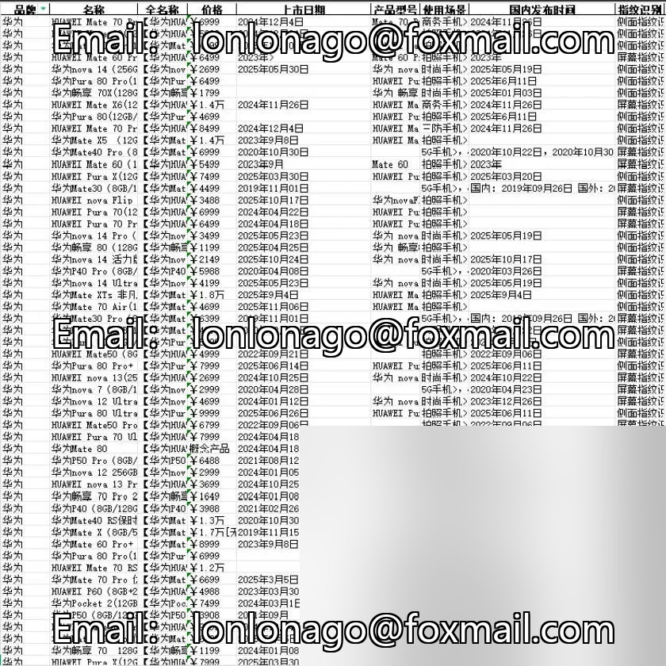
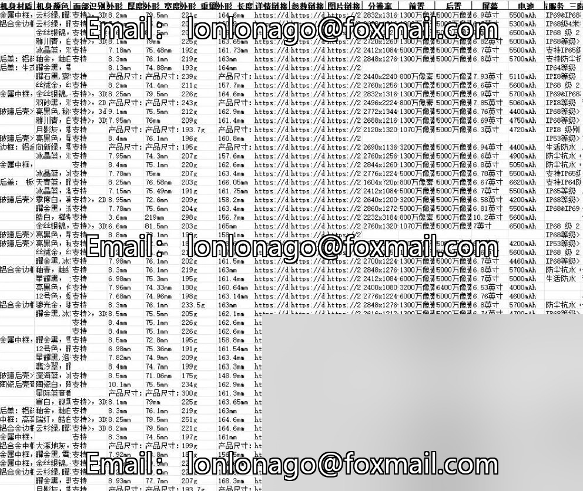

# Full smartphone brand specifications, parameters, functions, and database

## Body

Full mobile phone brand specification parameter function database

The dataset contains detailed specifications of over 19,000 smartphones and mobile devices from more than 200 brands, collected on 2025-12-20. It covers current market devices and historical model types traceable to 2000 years.

Time range: 2000 to 2025
Data source: All mobile phone data from Zhongguancun Online

Main functions and specifications of smartphones (including more than 110 specifications)
Brand  Name Full name Price Launch date Product model Use scenario Domestic release time Fingerprint recognition Body material Body color Face recognition Shape_thickness Shape_width Shape_weight Shape_length Details link Parameter link Image link Resolution Prefrontal Posterior Screen Battery and other more than 110 specification content

Brand scope (including brands that are discontinued)
The dataset includes equipment from major manufacturers, including:
Samsung, Apple, Xiaomi, Oppo, Vivo, Realme
OnePlus, Huawei, Honor, Nokia,
Motorola, Sony, ZTE, etc., 200 or more global brands

web-based shipment, can be directly photographed and shipped.

The dataset covers over 200 brands, more than 19,000 phones and mobile devices with detailed specifications, including current market devices and models traceable to 2000, spanning the period 2000 to 2025.

<!-- AI_ENRICHED -->

## Images

## Payment

Here is a pay link on Stripe ( https://buy.stripe.com/3cs8yP7sY87d0vu9AB ). Please contact me lonlonago@foxmail.com after funding $89, and I will send you a complete data files , thank you!

